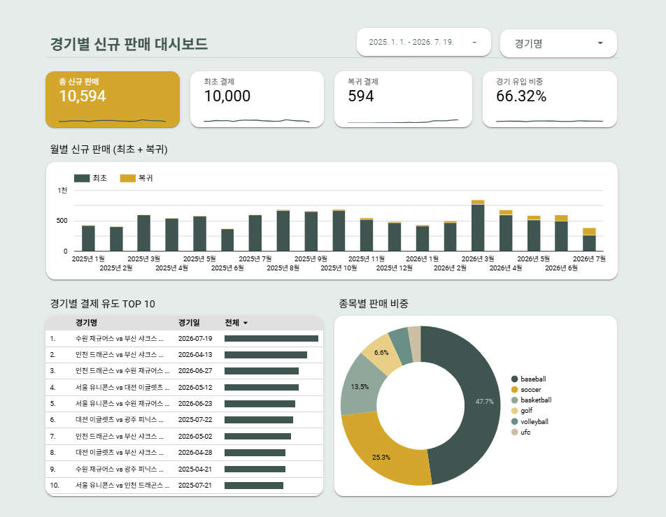

# OTT Sales Pipeline 📊

스포츠 OTT 구독 서비스의 **"경기별 신규 판매량" 리포팅 과정을 처음부터 끝까지 자동화한 개인 프로젝트**입니다.

실무에서 `SQL 추출 → 엑셀 가공 → 스프레드시트 복붙 → Looker Studio 확인`으로 반복하던 리포팅 프로세스를, 개인 환경에서 Python 파이프라인으로 재현했습니다. 회사 데이터는 일절 사용하지 않았으며, 구독 서비스의 데이터 구조를 직접 설계해 가상 데이터로 구현했습니다.

> Read the Data. Move the User.

## 파이프라인 구조

```
[데이터 생성]          [추출·가공]              [업로드]            [시각화]
generate_ott_data_v3  →  build_daily_sales   →  upload_to_sheets  →  Looker Studio
(가상 데이터 → SQLite)   (SQL 추출 + pandas 피벗)  (gspread 자동 업로드)   (자동 갱신)
```

- **데이터 생성**: 구독자 1만 명, 경기 일정 842건, 결제 이벤트(최초/복귀), 시청 로그 53만 행을 시뮬레이션하여 SQLite에 적재
- **추출·가공**: SQL로 결제-경기 데이터를 조인 추출 후, `일자 × 경기 × 권종(최초/복귀)` wide 포맷으로 피벗
- **업로드**: gspread + 서비스 계정으로 Google Sheets에 자동 반영 → 연동된 Looker Studio 대시보드가 자동 갱신

## 데이터 설계 포인트

실제 구독형 OTT 서비스의 판매 데이터 특성을 반영해 설계했습니다.

- **경기 귀속 판매**: 신규 결제의 65%가 특정 경기(결제 후 첫 시청 콘텐츠)에 귀속되며, 빅매치는 판매 견인력 3배
- **최초 vs 복귀**: 해지 유저의 일부가 재결제하는 복귀 패턴을 결제 이벤트 테이블(purchases)로 분리 모델링
- **권종 체계**: 자사 플랜(프리미엄/베이직/연간)과 제휴 채널 판매를 구분
- **시즌성**: 종목별 시즌(야구 3~10월 등)과 중계 편성 빈도를 경기 일정에 반영

## 대시보드

Looker Studio에서 KPI 스코어카드(총 판매·최초·복귀·경기 귀속률), 기간 필터, 경기별 판매 순위로 구성했습니다.

<!-- 스크린샷: 아래 줄의 이미지 경로를 실제 업로드한 파일명으로 바꿔주세요 -->


## 실행 방법

```bash
pip install pandas numpy gspread

python generate_ott_data_v3.py   # 가상 데이터 생성 → portfolio.db
python build_daily_sales.py      # 가공 → daily_match_sales.csv
python upload_to_sheets.py       # Google Sheets 업로드 (서비스 계정 필요)
```

업로드 단계는 Google Cloud 서비스 계정 키(`credentials.json`)와 대상 시트에 대한 편집 권한 공유가 필요합니다. 키 파일은 보안상 저장소에 포함되어 있지 않습니다.

## 기술 스택

`Python` `pandas` `SQLite` `gspread` `Google Sheets API` `Looker Studio`

## 만든 사람

구독 기반 스포츠 OTT 서비스에서 Growth 데이터 분석과 CRM 마케팅을 담당하고 있습니다.
이 프로젝트는 실무의 반복 리포팅 업무를 개인 환경에서 자동화 파이프라인으로 재구성한 학습 프로젝트입니다.
